# OrdiNovice CRM — l'outil de suivi d'un technicien informatique indépendant

> Un mini-CRM sur mesure, gratuit, hébergé dans Google Drive, utilisable sur PC **et** sur téléphone, pour suivre ses clients, ses interventions, ses règlements, ses contrats de maintenance et ses factures — sans jamais saisir deux fois la même information.

Conçu par **Jeff Madeline** ([OrdiNovice](https://www.ordinovice.fr) · [IA+Simple](https://iaplussimple.com)), technicien et formateur informatique depuis 20 ans, avec l'aide de Claude (Anthropic).

---

## Pourquoi cet outil ?

J'interviens chez des particuliers, des professionnels, des associations et des collectivités, sur place ou à distance. Pendant des années, j'ai suivi mon activité avec deux petits fichiers HTML dont les données restaient enfermées dans le navigateur de mon PC. Problèmes :

- impossible de saisir quoi que ce soit depuis mon téléphone, **chez le client** ;
- aucune liaison entre clients, interventions, règlements, crédit temps et maintenances ;
- des oublis : une intervention non facturée, une maintenance en retard, un rendez-vous sans suite.

L'objectif : **un seul outil**, accessible partout, qui relie tout automatiquement et **me rappelle ce que j'oublie**.

---

## L'outil en un coup d'œil

### Les fonctionnalités

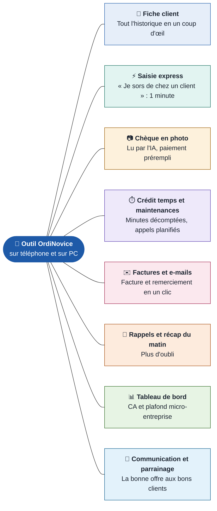

> Fonctionne avec Google Agenda, Drive, Gmail et Tâches · **Gratuit** (seule la lecture des chèques par l'IA coûte quelques centimes) · **Données privées** dans Google Drive, sauvegardées chaque semaine.

### Comment ça marche : une intervention, du début à la fin

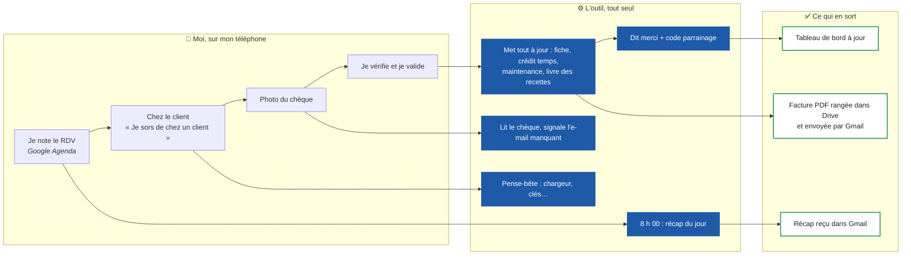

> **Et le lendemain ?** Un RDV noté dans l'agenda mais rien de saisi dans l'outil : il me le rappelle.

---

## Ce que fait l'outil, en détail

### 👤 Fiche client — le point d'entrée de tout
- Coordonnées, type de client (particulier, pro, association, collectivité), statut actif / inactif, parrain et **code parrainage**.
- **Historique chronologique complet** : interventions, règlements, crédit temps, maintenances, prestations gratuites, factures, photos de chèques.
- Depuis l'historique : **envoyer ou renvoyer une facture** à l'adresse de son choix, encaisser un règlement en attente, corriger ou supprimer une saisie.
- **Doublons signalés** (« Doublon probable ») avec suppression propre : la facture du doublon est annulée par un avoir.
- Recherche et filtres sur toute la base ; boutons d'action rapides : appeler, écrire, envoyer un mail.

### 📱 « Je sors de chez un client » — la saisie express sur mobile
- Un écran unique pour enregistrer l'intervention, le règlement et le commentaire en quelques secondes.
- **Menu des prestations lisible** : des cartes en couleurs pastel, regroupées par famille (Dépannage, Installation, Initiation et formation, IA+Simple, Crédit temps, Maintenance), avec le prix de chaque prestation.
- Chaque intervention est **obligatoirement** rattachée à une contrepartie : règlement, **règlement déjà saisi** (chèque reçu avant la prestation), crédit temps, appel de maintenance ou gratuité motivée.
- Les **coordonnées du client** (e-mail, téléphone, adresse) se complètent sur place, sans perdre la saisie en cours.
- Avant d'enregistrer, l'outil demande : créer la facture ? l'envoyer au client ? appliquer la réduction parrainage ?
- **Pièce jointe au mail** : un document enregistré une fois (le RIB, par exemple) se coche en un geste et part avec la facture ou le mail de remerciement.
- **Protection contre la double saisie** : un double appui ou un nouvel essai après une coupure réseau ne crée jamais deux prestations, et une saisie identique le même jour demande confirmation.
- Petit rappel bienveillant en sortant d'une intervention sur place : *ai-je bien repris mon chargeur, mes clés, mon sac… ?*
- Chaque bouton affiche « Patientez… » pendant que l'outil travaille : on sait toujours que le clic a été pris en compte, et un double clic ne déclenche rien deux fois.

### ⏱️ Crédit temps (forfaits d'assistance prépayés)
- Achat d'un forfait (90 min, 5 h, 10 h) → le crédit est **ajouté automatiquement** au solde du client.
- Chaque intervention décompte les minutes utilisées (arrondi à la tranche de 5 minutes entamée) ; solde négatif possible puis recharge.
- Historique daté des consommations avec leurs commentaires.

### 🛠️ Contrats de maintenance (6 ou 12 mois)
- Tarif, nombre d'appels de maintenance et appels inclus **personnalisables par client**.
- Au règlement, ouverture automatique de la **planification des appels** (mois + semaine S1 à S4), avec création de la tâche dans Google Agenda.
- Suivi visuel des appels du client inclus, commentaires propres à chaque contrat.
- Tableau de bord : maintenances **en retard**, **cette semaine**, **à venir**, et alertes de renouvellement.

### 🧾 Factures et encaissements
- Une facture par règlement, générée en PDF aux couleurs de la charte graphique, avec les mentions légales de la micro-entreprise et une numérotation chronologique continue.
- Envoi au client par e-mail depuis l'outil, au choix (l'outil demande avant de créer et d'envoyer), avec une pièce jointe si besoin (RIB), et renvoi possible à tout moment.
- Un avoir créé pour annuler un doublon de saisie n'est jamais envoyé au client.
- Règlement « pas encore payé » : à l'arrivée du chèque, **encaissement daté** (date d'encaissement, moyen, numéro de chèque) pour un livre des recettes juste.
- Une facture émise ne se supprime pas : correction par avoir, conformément aux règles légales.

### 📸 Lecture des chèques par IA
- Photo du chèque prise avec le téléphone → l'IA lit le montant, la date et le nom, **pré-remplit le règlement**.
- Comparaison avec la fiche client et signalement des différences et des informations manquantes (téléphone, e-mail).
- Archivage privé de la photo dans Google Drive, liée au règlement ; bouton « Rattacher la photo » pour un chèque reçu après coup.

### 🔔 Rappels et automatismes
- **E-mail récapitulatif chaque matin** : rendez-vous du jour, tâches Google, maintenances à faire.
- Rappel le lendemain d'un rendez-vous Google Agenda resté sans intervention ni règlement saisi.
- E-mail de remerciement après chaque prestation ou règlement, avec le code parrainage du client (un seul mail quand la facture part en même temps).
- Copie de sauvegarde hebdomadaire automatique de la base.

### 📊 Indicateurs
- Chiffre d'affaires par mois et par type de prestation, livre des recettes.
- Crédit temps vendu mais non consommé, taux de renouvellement des maintenances, clients inactifs.
- Suivi du plafond de chiffre d'affaires de la micro-entreprise ; récapitulatif annuel par client.
- Vue des 20 dernières prestations saisies.

### ✉️ Communication ciblée
- Sélection de clients par critères combinables (type, commune, inactif depuis X mois, sans maintenance, crédit épuisé…) et envoi d'e-mails depuis Gmail.
- Deux types d'envoi : **offres promotionnelles** et **infos arnaques et IA** (conseils utiles + mise en avant d'une prestation ou de la page Facebook).
- Tous les messages et encadrés d'offres se **modifient depuis l'outil**, avec aperçu ; mails à la charte avec photo et logos.
- Respect du consentement : case « accepte de recevoir les offres » par client et désinscription « STOP ».

### 🤝 Parrainage
- Chaque client a un **code parrainage** (ex. `DUPONT-7K2A`), visible sur sa fiche et rappelé dans le mail de remerciement.
- À la création d'un nouveau client, on saisit le nom ou le code du parrain : le parrainage est enregistré une seule fois par filleul.
- **Réduction de 5 €, une seule fois** pour le filleul et une seule fois pour le parrain, proposée automatiquement à leur prochaine prestation et indiquée sur la facture.
- Garde-fous : pas d'auto-parrainage, un seul parrain par filleul, réduction liée à un règlement et rendue seulement si ce règlement est supprimé.

---

## Stack technique

| Brique | Rôle |
|---|---|
| **Google Sheets** | Base de données (un onglet par table : clients, prestations, règlements, crédit temps, maintenances, factures, paramètres…) |
| **Google Apps Script** | Toute la logique métier, côté serveur (JavaScript) |
| **Apps Script Web App** | L'interface (HTML / CSS / JavaScript), responsive, utilisable sur PC et téléphone, ajoutable à l'écran d'accueil |
| **Gmail** (`MailApp`) | Envoi des factures, remerciements, récapitulatif matinal, campagnes ciblées |
| **Google Agenda** (`CalendarApp`) | Lecture des rendez-vous clients, création des appels de maintenance |
| **Google Tasks** (service avancé) | Tâches du jour dans le récapitulatif matinal |
| **Google Drive** (`DriveApp`) | Factures PDF, photos de chèques, pièces jointes des mails, sauvegardes |
| **API Claude** (Anthropic) | Lecture des photos de chèques |
| **Déclencheurs Apps Script** | Tâches planifiées (récap du matin, rappels, sauvegarde hebdomadaire) |

**Pourquoi ce choix ?**
- **Gratuit** : tout tient dans un compte Google classique ; seule la lecture des chèques par IA coûte quelques centimes par photo.
- **Mes données restent chez moi**, dans mon Google Drive.
- **Aucun serveur à maintenir**, pas d'hébergement, pas de mises à jour système.
- **Maintenable par un non-développeur** : la base est un simple tableur lisible.

Limites connues : quotas d'envoi Gmail d'un compte gratuit (environ 100 destinataires par jour), temps de réponse d'Apps Script parfois de 1 à 2 secondes.

---

## Architecture

```
 Téléphone / PC (navigateur)
          │
          ▼
 Application web Apps Script ──► Google Sheets (base de données)
          │
          ├──► Gmail        (factures, remerciements, récap du matin)
          ├──► Agenda       (rendez-vous, appels de maintenance)
          ├──► Tasks        (tâches du jour)
          ├──► Drive        (PDF, photos de chèques, sauvegardes)
          └──► API Claude   (lecture des chèques)
```

---

## Captures d'écran

*Les noms, coordonnées et références visibles sont fictifs.*

### Accueil
Les actions du quotidien en un clic, et les règlements en attente.

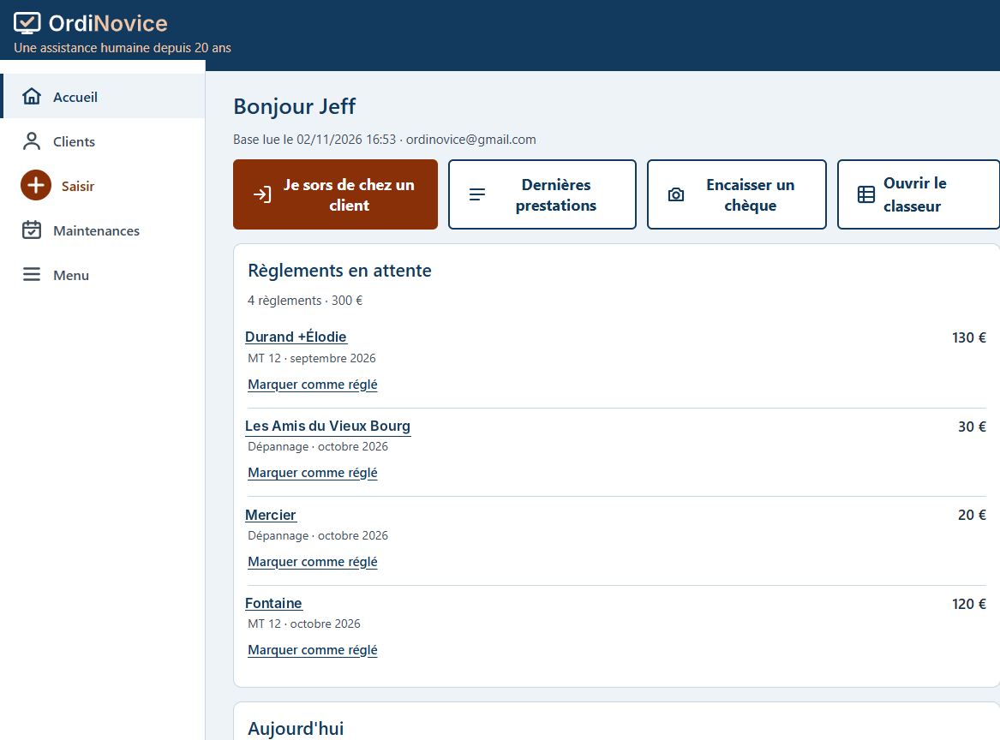

### Base clients
Recherche instantanée et filtres : actifs, contrat en cours, crédit temps, informations manquantes, inactifs.

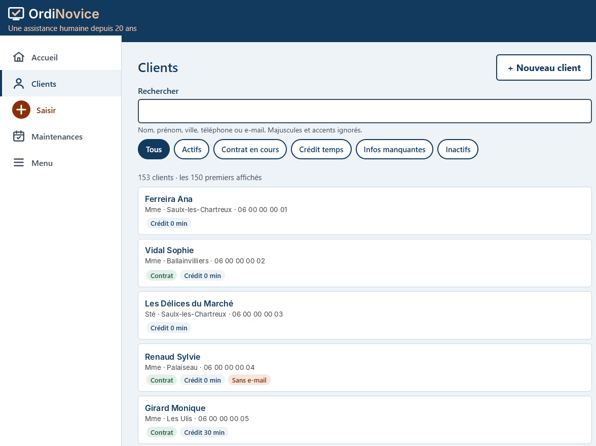

### Saisir une intervention
Le pense-bête « Avant de partir », puis une saisie rapide : lieu, durée, ce qui a été fait.

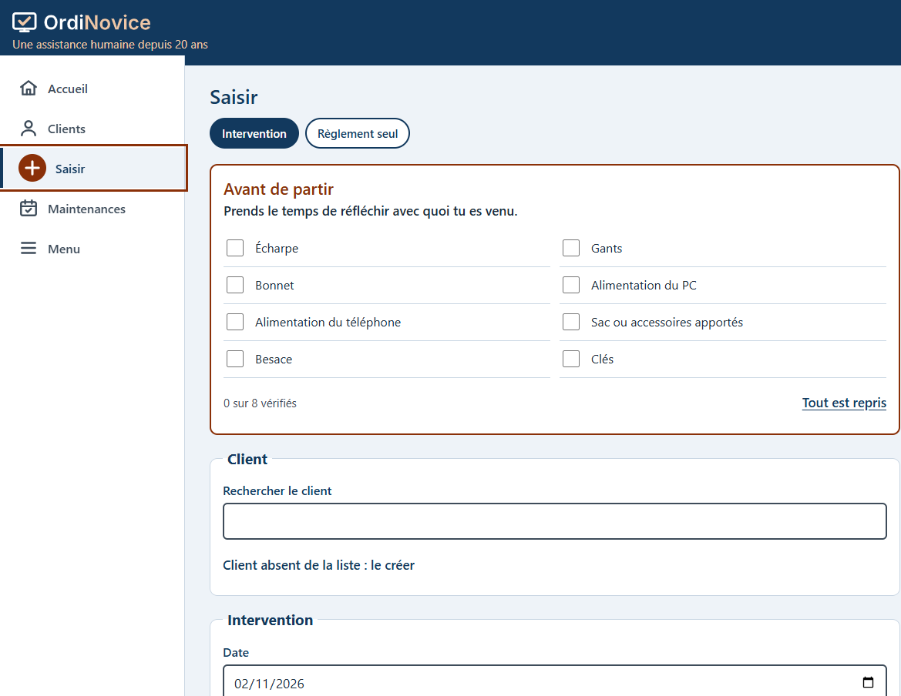

Chaque intervention est obligatoirement rattachée à une contrepartie : règlement, crédit temps, appel de maintenance, appel inclus ou gratuité motivée.

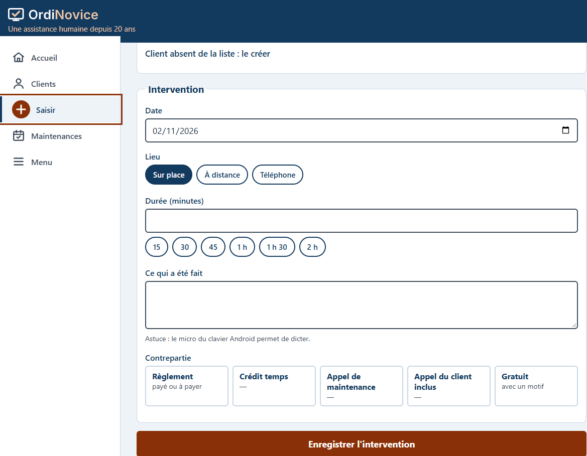

### Dernières prestations
Les 20 dernières saisies, avec un lien direct vers chaque facture.

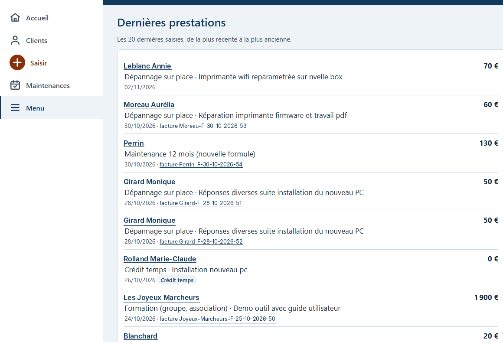

### Crédit temps
Le solde de chaque client, par type de forfait, et le total encore dû.

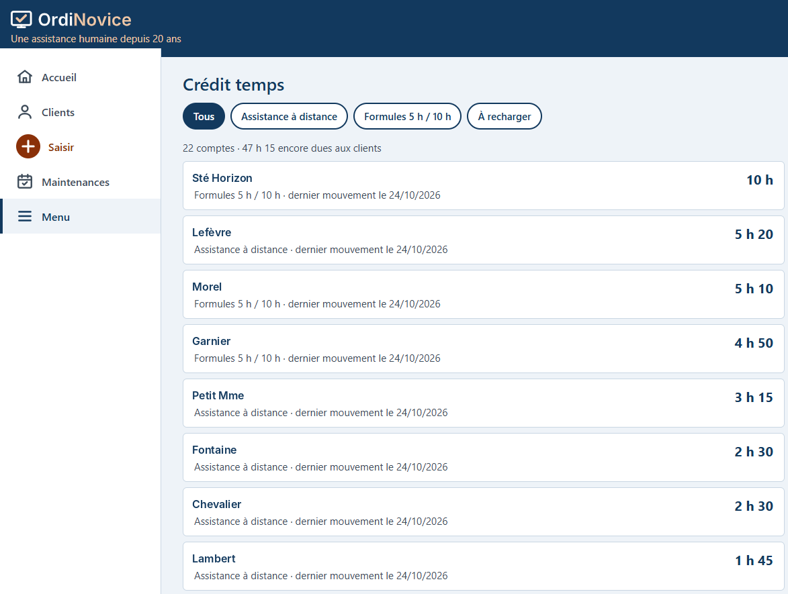

### Maintenances
Les appels de maintenance en retard, de la semaine et à venir, avec les actions : appeler, fixer le rendez-vous, décaler, ignorer.

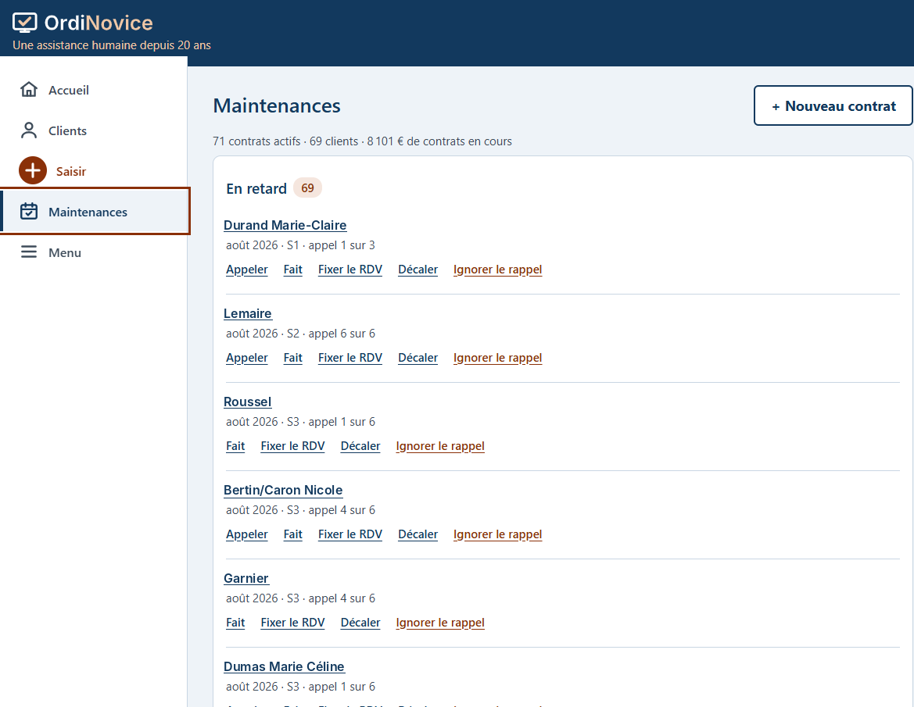

### Encaisser un chèque
Photo du chèque, lecture par l'IA et suivi de la dépense.

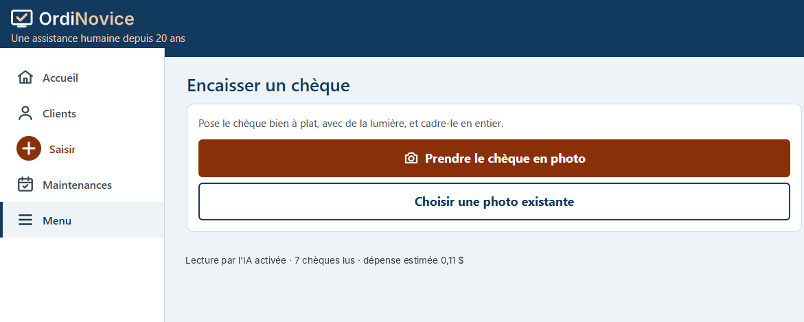

### Facture
Générée automatiquement aux couleurs de la charte, avec les mentions légales de la micro-entreprise.

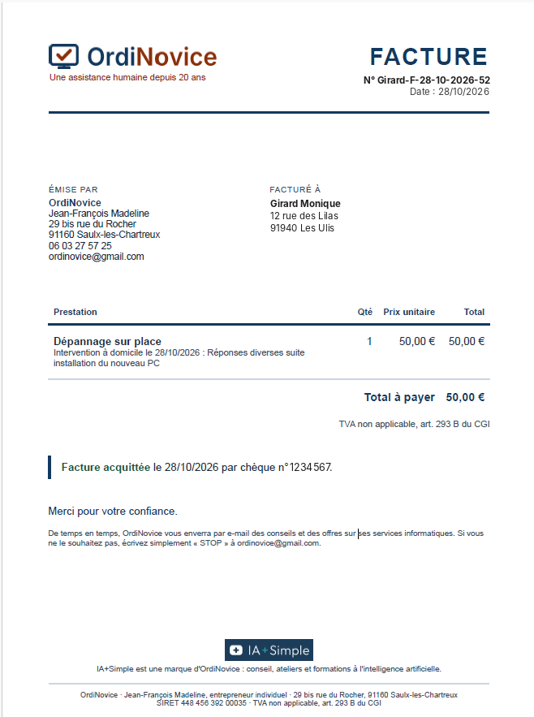

### Menu
Toutes les rubriques de l'outil.

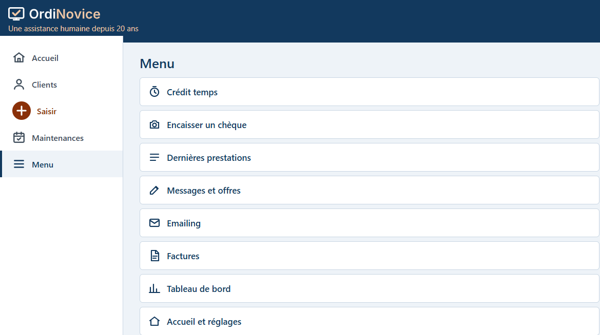

---

## Sécurité et RGPD

- **Aucune donnée client n'est publiée dans ce dépôt**, qui présente l'outil sans son code. Les données vivent dans un Google Drive privé.
- La clé API n'est jamais écrite dans le code : elle est stockée à part, dans les propriétés protégées du projet.
- L'application web n'est accessible qu'au propriétaire du compte Google.
- Les photos de chèques sont stockées dans un dossier Drive privé.
- L'e-mailing respecte le consentement et propose systématiquement la désinscription.

---

## Feuille de route

- [x] Base de données Google Sheets et reprise de l'historique 2026
- [x] Fiches clients, saisie mobile, crédit temps, maintenances
- [x] Factures PDF et envoi par e-mail
- [x] Lecture des chèques par IA
- [x] Récapitulatif matinal et rappels
- [x] E-mailing ciblé, messages modifiables, infos arnaques et IA
- [x] Remerciement automatique, parrainage, protection contre la double saisie
- [x] Menu des prestations en couleurs, prestations IA+Simple, pièces jointes aux mails, indicateur « Patientez »
- [ ] Lien vers un avis Google dans tous les mails
- [ ] Synchronisation des fiches clients vers Google Contacts (sans toucher aux contacts personnels)
- [ ] Rubrique IA+Simple (promotion des ateliers et services IA)

---

## Droits

© 2026 Jean-François Madeline — OrdiNovice. Tous droits réservés.

Ce dépôt présente l'outil ; le code source n'est pas publié pour le moment.

## Contact

**Jeff Madeline** — OrdiNovice / IA+Simple
[iaplussimple.com](https://iaplussimple.com) · Page Facebook « iaplussimple »
