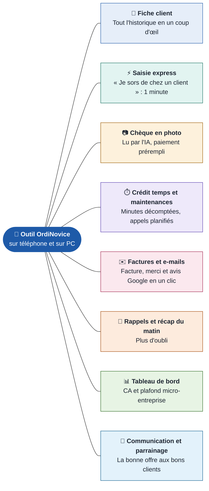
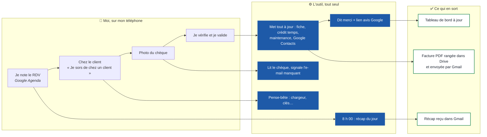

## Ce que fait l'outil

> Fonctionne avec Google Agenda, Drive, Gmail, Contacts et Tâches · **Gratuit** (seule la lecture des chèques par l'IA coûte quelques centimes) · **Données privées** dans Google Drive, sauvegardées chaque semaine.

## Comment ça marche : une intervention, du début à la fin

> **Et le lendemain ?** Un RDV noté dans l'agenda mais rien de saisi dans l'outil : il me le rappelle.
